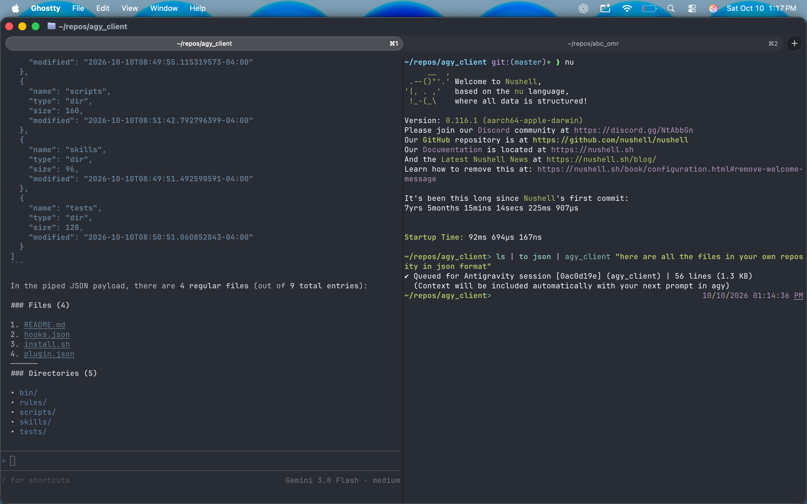
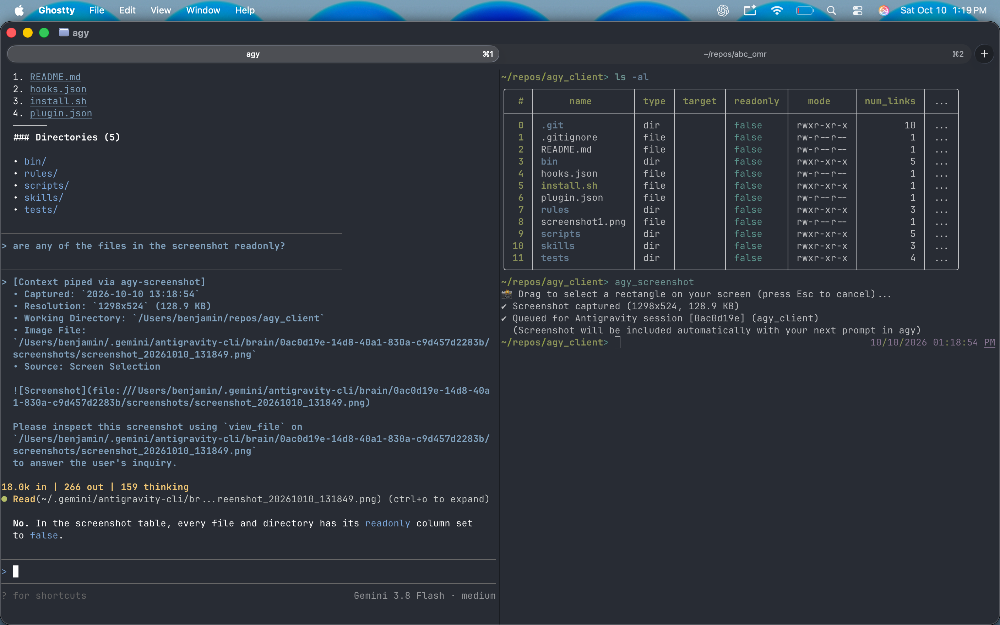
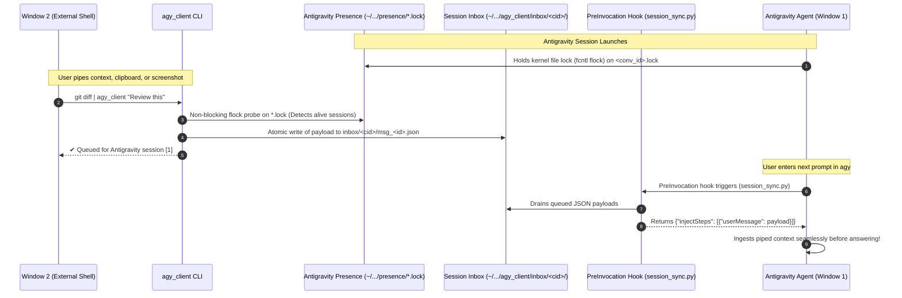

# agy-client: Antigravity Pipe Context Plugin & CLI

<p align="center">
  <a href="https://github.com/denvercoder1/readme-typing-svg">
    
  </a>
</p>

`agy-client` is an Antigravity plugin and standalone CLI that allows you to pipe terminal outputs, code diffs, logs, and screenshots directly into an active Antigravity session from any command prompt in another window:

```bash
ls | agy_client
git diff | agy_client "Please review these changes"
pytest 2>&1 | agy_client "Why did this test fail?"
```

---

## Live Demos: See It in Action

### 1. Piping Structured Output & Terminal Context (`agy_client`)



> **Caption / Execution Flow:**
> 1. **Command on the right happened first**: In the right terminal pane (running Nushell), directory contents were converted to JSON and piped via `ls | to json | agy_client "here are all the files in your own reposity in json format"`. The `agy_client` CLI discovered the active session `[0ac0d19e]` via kernel presence locks and instantly queued the payload into the session's private inbox.
> 2. **Antigravity session on the screen (left) happened next**: In the left terminal pane running Antigravity (`agy`), the agent's `PreInvocation` lifecycle hook drained the inbox and injected the piped JSON data into the turn context. The agent parsed the data and answered with a structured breakdown of the repository's files and directories.

---

### 2. Capturing & Querying Visual Screen Regions (`agy-screenshot`)



> **Caption / Execution Flow:**
> 1. **Command on the right happened first**: In the right terminal pane showing an `ls -al` table, the user executed `agy_screenshot`. macOS crosshairs appeared, allowing the user to select the table region. The CLI captured the screenshot (`1298x524`) and queued it for the active Antigravity session `[0ac0d19e]`.
> 2. **Antigravity session on the screen (left) happened next**: In the left terminal pane running Antigravity (`agy`), the user asked *"are any of the files in the screenshot readonly?"*. Antigravity received the piped screenshot notification, used `view_file` to visually inspect the captured image, and answered that every entry in the table had its `readonly` attribute set to `false`.

---

## Architecture Overview

When Antigravity (`agy`) is running, each session operates independently in its workspace with its own lifecycle hooks and conversation context.

An external command prompt running in another terminal window needs a reliable, zero-configuration way to send context into Antigravity without fragile network setups, port conflicts, or requiring in-memory environment variables (`ANTIGRAVITY_LS_ADDRESS`, CSRF tokens, etc.).

`agy-client` solves this with a **zero-network, file-based inbox queue and lifecycle hook injection architecture**:



---

### Architectural Design & Core Mechanisms

#### 1. The Session Discovery Evolution: From Brittle Hooks to Native Presence Locks

* **The Problem with Hook-Based Discovery**:
  Initial designs attempted to discover running sessions by using Antigravity lifecycle hooks (`PreInvocation`, `PostToolUse`) to serialize connection state to a custom JSON registry. However, Antigravity lifecycle hooks **only execute when a turn is in flight or a tool is executed**. When an agent session is freshly launched and waiting at the interactive prompt, no invocation has occurred—meaning hooks never fired. This led to race conditions where `agy_client` reported `"No active Antigravity session found"` or routed context to stale sessions. Furthermore, events like `"SessionStart"` are not supported lifecycle hooks in Antigravity.

* **The Solution: Native Kernel-Level Presence Locks**:
  Whenever Antigravity (`agy`) starts in any directory, it creates a presence file in `~/.gemini/antigravity-cli/presence/<conversation_id>.lock` and maintains an exclusive, advisory file lock on it (`flock`).
  
  `agy_client` inspects active sessions by probing these locks via non-blocking kernel calls (`fcntl.flock(fd, LOCK_EX | LOCK_NB)`):
  * **Lock Busy (`BlockingIOError` / `EWOULDBLOCK`)**: An `agy` process is actively holding the lock. The session is alive and ready to receive input.
  * **Lock Acquired**: No process holds the lock; the file is released and skipped.
  * **Zero Polling & Zero Lag**: Once initialized, an active session is discoverable immediately without polling. If the agent process exits or crashes, the OS kernel automatically releases the lock immediately.

> [!NOTE]
> **First-Prompt Session Initialization**:
> When you launch a fresh Antigravity session (`agy`), Antigravity allocates its conversation ID, creates its presence lock, and triggers plugin hooks when the first turn begins. **Enter at least one initial prompt (or send a quick greeting like `hello`) in a newly opened Antigravity session before piping context from another terminal.** Once that first turn runs, `agy_client` will detect the session and its workspace directory automatically.

#### 2. Metadata Querying & Intelligent Session Routing

Once active conversation IDs are identified via presence locks:
* **Workspace Resolution**: `agy_client` reads session workspace metadata synchronized by the session's PreInvocation hook (`~/.gemini/antigravity-cli/agy_client/sessions/<cid>.json`), with fallback inspection of conversation transcript CWD records.
* **Smart 3-Tier Session Resolution**:
  1. **Explicit Targeting (`-s <id|num>`)**: Users can specify either a full/partial conversation UUID or a simple 1-based index (e.g. `agy_client -s 1` or `agy_client -s 2`) as listed in `agy_client --list`.
  2. **Workspace / Working Directory Matching**: If no session is explicitly passed, `agy_client` compares the caller's current working directory (`os.getcwd()`) against the workspace root of all active sessions. If the caller is within a session's workspace tree, it is prioritized automatically.
  3. **Recency Fallback**: If run from an unrelated directory (e.g. `~`), `agy_client` selects the most recently updated or created active session.

#### 3. Multi-Modal Clipboard & Media Pipeline

`agy_client` integrates deep clipboard and visual asset handling directly into the CLI:
* **Clipboard Sniffing**: Inspects the macOS pasteboard to detect whether content is a binary raster image (`«class PNGf»`), plain text (`pbpaste`), or empty.
* **Auto-Routing**:
  * If an image is copied (e.g. via `Cmd+Shift+4` or `Cmd+Ctrl+Shift+4`), `agy_client -c` extracts the PNG stream, saves it securely to the target session's `screenshots/` directory, extracts dimensions via a zero-dependency PNG chunk parser, and formats a visual prompt.
  * If text is copied, it pipes the text content wrapped in Markdown blocks.
  * If `agy_client` is invoked with no standard input and no arguments, it automatically inspects the clipboard and pipes whatever is available.
* **Standalone Capture (`agy-screenshot`)**: Provides an interactive macOS crosshairs selection (`screencapture -i -s -x`) or window capture (`--window`), with a direct `--clipboard` (`-c`) mode to bypass crosshairs when an image is already in the pasteboard.

#### 4. Decoupled Inbox Delivery & Agentic Ingestion

* **Atomic Local Inbox Queue**:
  Instead of fragile network RPCs, socket listeners, or requiring environment variables like `ANTIGRAVITY_LS_ADDRESS`, `agy_client` writes formatted context payloads atomically into a private per-session inbox queue:
  `~/.gemini/antigravity-cli/agy_client/inbox/<conversation_id>/msg_<timestamp>.json`
* **Seamless Ingestion via `PreInvocation` Hook**:
  Whenever the user enters their next prompt in the target Antigravity session, Antigravity triggers the plugin's `PreInvocation` hook (`scripts/session_sync.py`). The hook:
  1. Synchronizes the session's current workspace directory for accurate CLI discovery.
  2. Drains all queued messages from the inbox.
  3. Injects them into the turn using `injectSteps: [{"userMessage": payload}]`.
  
  The agent automatically ingests the queued context right alongside your input.
* **Progressive Skills & Rules**:
  * **`skills/piped-context/`**: Loaded by Antigravity to guide the model on how to handle incoming external context blocks (interpreting diffs, test logs, error traces, and directory listings).
  * **`rules/AGENTS.md`**: Enforces that incoming `[Context piped via agy_client]` and `[Context piped via agy-screenshot]` messages are treated with high priority as live user input, and instructs multimodal models to inspect screenshot image paths using `view_file` immediately.

---

## Installation & Setup

Run the automated installer script:

```bash
git clone https://github.com/<owner>/agy-client.git
cd agy-client
./install.sh
```

The script will:
1. Verify Python 3 and Antigravity prerequisites.
2. Validate the plugin with `agy plugin validate .`.
3. Install the plugin into Antigravity with `agy plugin install .`.
4. Symlink `bin/agy_client` into `~/.local/bin/agy_client`.
5. Seed the session registry for any currently active session.

Ensure `~/.local/bin` is in your `PATH` (e.g. in `~/.zshrc` or `~/.bashrc`):
```bash
export PATH="$HOME/.local/bin:$PATH"
```

---

## Usage Examples

### 1. Basic Pipe
Pipe any command output from another terminal window directly into the active session:

```bash
ls -la | agy_client
```

### 2. Pipe with Prompt / Note
Attach instructions or questions along with the piped stream:

```bash
git diff | agy_client "What do you think of this change?"
```

```bash
pytest 2>&1 | agy_client "Analyze this test failure and propose a patch"
```

### 3. Send Text Prompt without Pipe
Use `agy_client` to send quick messages directly to Antigravity without switching windows:

```bash
agy_client "Remember to run linter before committing"
```

### 4. Pipe Clipboard Image or Text (`-c`, `--clipboard`)
Instantly pipe whatever is in your macOS clipboard (screenshots captured via `Cmd+Shift+4` / `Cmd+Ctrl+Shift+4`, or copied text) directly into Antigravity:

```bash
# Pipe image or text currently copied in clipboard
agy_client -c "Look at this screenshot in my clipboard"

# Or use agy-screenshot with -c
agy-screenshot -c "Inspect this diagram"
```

If you run `agy_client` alone without piped input, it automatically detects if an image or text is in your clipboard and pipes it!

### 5. Multi-Session Management & Index Targeting
If you have multiple Antigravity sessions running across different terminals or projects:

```bash
# List all active sessions, status, and matched workspace
agy_client --list

# Output:
# Active Antigravity Sessions (2):
#  *[1] 6eb017fe-2c8... (Status: alive) (matches current dir)
#       Workspaces: /Users/developer/repos/agy_client
#   [2] 02c1f373-cd3... (Status: alive)
#       Workspaces: /Users/developer/repos/my_project

# Target by simple session number (e.g. 1 or 2):
git status | agy_client -s 2 "Check git status in abc_omr"
agy_client -s 1 "Check health"
```

### 6. Capture & Pipe Screen Selection (`agy-screenshot`)
Select a rectangle on your screen interactively and pipe it directly to Antigravity:

```bash
# Crosshairs appear; drag a rectangle to capture and pipe to Antigravity
agy-screenshot

# Capture rectangle with an accompanying question or instruction
agy-screenshot "What is causing this visual bug in the UI?"

# Grab what is ALREADY in your clipboard (no crosshairs needed)
agy-screenshot -c "Review this copied screenshot"

# Capture a specific window instead of rectangle
agy-screenshot --window "Inspect this application window"

# Add delay (e.g. 3 seconds) to open a dropdown or context menu first
agy-screenshot --delay 3 "Is this dropdown accessible?"
```

Antigravity immediately receives the screenshot image and uses `view_file` to inspect the visual contents.

> [!NOTE]
> **macOS Permissions Required**:
> The `agy-screenshot` utility relies on macOS `screencapture`. Your terminal emulator (e.g., Terminal, iTerm2, Kitty, Ghostty, Alacritty) must be granted **Screen Recording** permissions in:
> **System Settings > Privacy & Security > Screen Recording**
>
> If permission is missing, macOS may show a permission prompt or capture only your desktop background without window contents.

### 6. Check Connection Status
Verify whether `agy_client` can reach the active Antigravity session:

```bash
agy_client --status
```

---

## Directory Structure

```text
agy_client/
├── plugin.json                 # Antigravity Plugin manifest
├── hooks.json                  # Lifecycle hook manifest (PreInvocation -> session_sync.py)
├── install.sh                  # Automated installer and setup script
├── bin/
│   ├── agy_client              # Standalone executable CLI entrypoint
│   └── agy-screenshot          # Standalone screenshot capture CLI entrypoint
├── scripts/
│   ├── agy_client_core.py      # Core CLI logic, session discovery, payload formatter
│   └── session_sync.py         # PreInvocation hook handler (synchronizes sessions & drains inbox)
├── skills/
│   └── piped-context/
│       └── SKILL.md            # Skill guiding the agent on handling incoming piped context
├── rules/
│   └── AGENTS.md               # Behavioral rules for processing piped context
├── tests/
│   └── test_client.py          # Unit tests
└── README.md                   # Documentation and architecture guide
```

---

## Security Warnings & Architecture

### Security Principles & Threat Model

- **Zero-Network Attack Surface**: Communication does not open or listen on local or remote network ports. No HTTP/RPC servers, loopback sockets, external telemetry, or outbound connections are used.
- **Access Control & Permissions**:
  - Inbox queues and session metadata are stored in `~/.gemini/antigravity-cli/agy_client/`.
  - Directories are created with strict `0700` (`drwx------`) permissions and message JSON files with `0600` (`-rw-------`) permissions, preventing unauthorized access from other local accounts on shared multi-user systems.
  - Captured screenshots are stored in the session brain directory with `0600` file permissions.
- **Kernel-Level Session Liveness**: Sessions are detected using POSIX advisory locks (`fcntl.flock`) on Antigravity's native presence lock files (`~/.gemini/antigravity-cli/presence/*.lock`), with instant kernel cleanup on process exit or crash.
- **Payload Boundaries & DoS Protection**: Payloads exceeding 1 MB are automatically truncated with a warning to protect agent memory and token limits.
- **Safe Command Invocation**: All subprocess calls avoid `shell=True` and pass structured argument lists directly to the OS to eliminate shell injection vulnerabilities.

### Important Warnings for Users

> [!WARNING]
> **Piping Untrusted External Content (Indirect Prompt Injection)**:
> If you pipe raw terminal output from untrusted web endpoints or third-party tools (such as `curl https://untrusted-api.com | agy_client` or unverified external build logs), the input could contain adversarial text or prompt injection attempts designed to mislead the AI agent.
> 
> `agy-client` encloses all piped content inside Markdown code fences labeled with `[Context piped via agy_client]` to help the agent distinguish between data and instructions. However, you should always review external data before piping it into an agent session with tool-execution privileges.

> [!CAUTION]
> **Screen Content Privacy**:
> When using `agy-screenshot`, ensure that sensitive information (such as credentials, API keys, private messages, or confidential customer data) is not visible in the captured screen region, as the captured image is loaded into the agent's context window.
